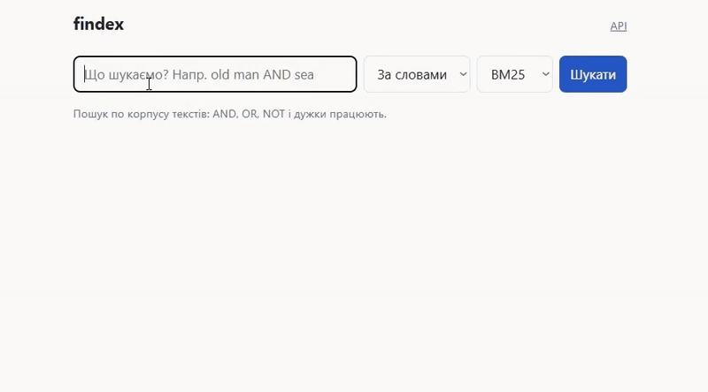

**[Відео-демо Лаби 8](https://youtu.be/fby6FQI7Cjc)**

### Лаба 8 — швидше, потім розумніше

**Профіль до змін** (cProfile, 10 пошуків `war OR money OR gold`; профайлер сильно роздуває код із мільйонами
дрібних викликів, тож довіряю порядку функцій, а не секундам):

| # | Місце | Власний час | Викликів |
|---|---|---:|---:|
| 1 | `tokens.token_spans` | 27.1 с | 10 422 346 |
| 2 | `snippets._best_center` | 5.7 с | 100 |
| 3 | `snippets._find_matches` | 3.2 с | 100 |

`make_snippet` разом дає 96% часу, а скорер BM25 у топ-15 не потрапив: кожен запит заново токенізував десять
цілих книжок заради сніпетів. Flame graph: [`docs/search.svg`](docs/search.svg) (до) і
[`docs/search_after.svg`](docs/search_after.svg) (після).

**Що змінила і що вийшло** (деталі: [`docs/profile_before.md`](docs/profile_before.md), [`docs/profile_after.md`](docs/profile_after.md)):

| Зміна | Результат |
|---|---|
| токени книжок рахуються один раз і зберігаються як масиви NumPy; пошук збігів через `np.isin` | сторінка зі сніпетами **1286 -> 2.8 мс** (медіана) |
| `_best_center`: ковзне вікно замість O(m²) | 5.7 с на 100 викликів → 1.3 с на 2000 викликів; сніпети посимвольно ті самі (тест) |
| скорер BM25/TF-IDF на NumPy (CSR-постінги `int32`, `argpartition`) | на **20 документах 0.2–0.8×** від циклу з Лаби 3; на **50 000 синтетичних документів ×16–22**; рейтинг той самий з точністю до порядку при рівних оцінках (тест) |
| `tokenize` для індексації без позицій | лише ×1.11 (1.93 -> 1.74 с) |

Ціна виграшу: масиви токенів і тексти тримаються в пам'яті (~40 МіБ у постійному стані, ~120 МіБ пік під час
побудови, на кожного воркера окремо), а побудова перенесена на старт сервера (перший запит до книжки без
цього коштував ~2.1 с). Вузьке місце тепер: `np.isin` у сніпеті (2 мс на сніпет), далі не оптимізувала.
`py-spy` не запрацював на Python 3.14, тому flame graph побудовано з cProfile через `flameprof`
(детермінований профіль).

**Навантаження після змін** (`oha`, 30 с, `q=chess`, v1.0.0; сніпети й NumPy-скорер):

| Ціль | Одночасних | RPS | p50 (мс) | p95 (мс) | p99 (мс) |
|---|---:|---:|---:|---:|---:|
| локально, 1 воркер (Лаба 7) | 50 | 7.23 | 7921 | 12600 | 15181 |
| **локально, 1 воркер (v1.0.0)** | 50 | **286.2** | **168** | **235** | **292** |
| Render (Лаба 7) | 20 | 6.30 | 3392 | 4495 | 4600 |
| **Render (v1.0.0)** | 20 | **54.7** | **392** | **498** | **638** |

У вимірі на Render ~150 мс — це мережа до сервера (`DNS+dialup` в `oha`), яких локально немає. Сирі виводи:
[`docs/oha/`](docs/oha/).

**Семантичний і гібридний пошук.** Текст ріжеться на шматки по ~150 слів; модель `all-MiniLM-L6-v2` (ONNX через
`fastembed`) дає вектор довжини 384; вектори нормовані, тому косинус — це добуток `E @ q` (9092 шматки,
13.4 МБ). Документ оцінюється за найкращим шматком. Гібрид зливає два списки (BM25 по OR зі слів запиту і семантичний)
через Reciprocal Rank Fusion: оцінка = Σ 1/(60 + місце), бо оцінки BM25 і косинуса в різних шкалах, а місця
порівнювані. Precision@5 (у дужках — місце першого правильного документа; `BM25 (AND)` — так, як працює
рушій за замовчуванням):

| Запит | BM25 (AND) | BM25 (OR) | semantic | hybrid |
|---|---:|---:|---:|---:|
| athenians | 0.40 (#1) | 0.40 (#1) | 0.40 (#1) | 0.40 (#1) |
| wages | 0.40 (#1) | 0.40 (#1) | 0.40 (#1) | 0.40 (#1) |
| war | 0.40 (#1) | 0.40 (#1) | 0.40 (#1) | 0.40 (#1) |
| money | 0.40 (#1) | 0.40 (#1) | 0.40 (#1) | 0.40 (#1) |
| gold | 0.40 (#1) | 0.40 (#1) | 0.40 (#1) | 0.40 (#1) |
| computers | 0.80 (#1) | 0.80 (#1) | 0.60 (#1) | 0.80 (#1) |
| machines | 0.40 (#1) | 0.40 (#1) | 0.60 (#1) | 0.40 (#1) |
| electronic | 0.60 (#1) | 0.60 (#1) | 0.40 (#1) | 0.60 (#1) |
| alchemy | 0.20 (#1) | 0.20 (#1) | 0.20 (#1) | 0.20 (#1) |
| hackers | 0.40 (#1) | 0.40 (#1) | 0.40 (#1) | 0.40 (#1) |
| **середнє** | 0.44 | 0.44 | 0.42 | 0.44 |

Перефразовані запити (`eval/queries_paraphrase.json`: слова запиту не збігаються зі словами в текстах):

| Запит | BM25 (AND) | BM25 (OR) | semantic | hybrid |
|---|---:|---:|---:|---:|
| women refuse to sleep with their husbands to end a conflict | 0.00 (–) | 0.20 (#1) | 0.20 (#1) | 0.20 (#1) |
| medieval attempts to turn lead into gold | 0.20 (#1) | 0.20 (#1) | 0.20 (#2) | 0.20 (#1) |
| teenagers fighting government surveillance after a terror attack | 0.20 (#1) | 0.20 (#1) | 0.20 (#1) | 0.20 (#1) |
| why prices rise when there is too much cash around | 0.20 (#1) | 0.40 (#1) | 0.40 (#1) | 0.40 (#1) |
| machines that can reason like people | 0.20 (#1) | 0.20 (#1) | 0.40 (#1) | 0.20 (#1) |
| **середнє** | 0.16 | 0.24 | **0.28** | 0.24 |

Що з цього випливає: на запитах, слова яких є в текстах, семантика не краща за BM25 (0.42 проти 0.44). На
перефразованих вона виграє: найяскравіше «women refuse…» — пошук за словами (AND) не знаходить нічого, а семантичний
ставить першою «Лісістрату»; з другого боку, у «lead into gold» слово «gold» тягне книжки про гроші, і алхімічна
книжка опиняється другою (гібрид повертає її на перше місце). Гібрид тут не кращий за чистий семантичний режим,
бо його лексична частина — це OR по всіх словах запиту, зокрема службових («turn», «into»).