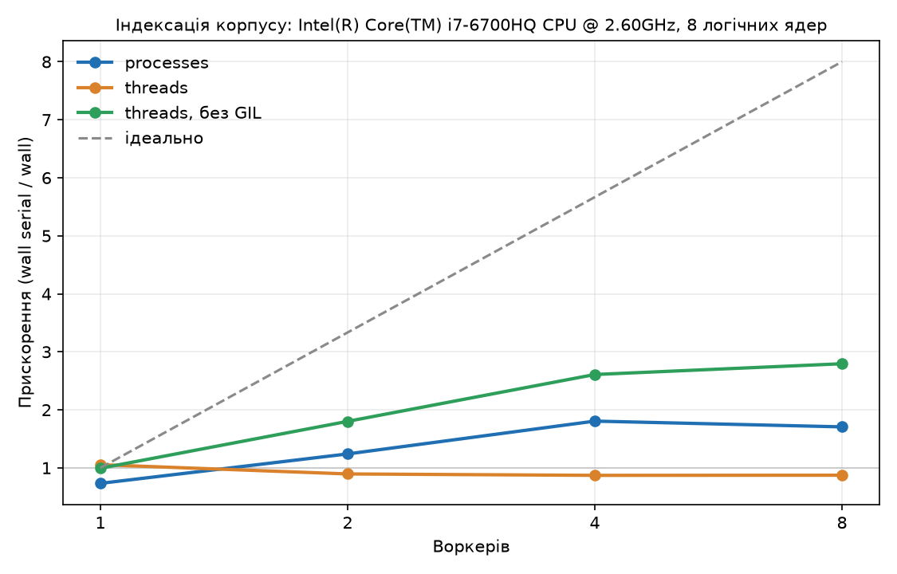

## Lab 1 — Iterators & the corpus of project

Корпус: 20 книг з Project Gutenberg (англійська + одна французька — Renan,
"Vie de Jésus"). Разом: ~15 МБ тексту.

`iter_documents()` читає файли по одному через генератор, не тримає весь
корпус у пам'яті одночасно. Ріже службовий текст ліцензії Gutenberg по
маркерах START/END.

`tokenize()` — теж генератор. Апострофи (`don't`) і дефіси
(`state-of-the-art`) тримаю всередині токена, підкреслення (Gutenberg
позначає ним курсив, типу `_Ask_`) прибираю як розмітку. Цифри лишаються токеном цілком, включно з роздільником (1,000, 3.14). Unicode
нормалізую через NFKC, щоб криві апострофи (’) і прямі (') давали
однаковий токен. 9 тестів на ці правила — `tests/test_tokens.py`.

### Генератор vs списки

| Підхід     | Час    | Пікова пам'ять |
|------------|--------|----------------|
| Генератори | 8.03 с | 18.98 МБ       |
| Списки     | 7.14 с | 86.26 МБ       |

Різниця в пам'яті майже у 4.5 рази більше, а час майже однаковий, бо кількість
операцій токенізації та сама, різниця тільки в тому, скільки всього
одночасно висить у пам'яті. У "жадібній" версії одночасно тримаються і весь
список документів, і список з 1 374 875 окремих рядків-токенів, а кожен
рядок в Python - це окремий об'єкт з накладними витратами.

Побічний ефект мультимовного корпусу: у топ-50 термів були
французькі стоп-слова (de, et, la) - з тієї самої книги Ренана.


## Lab 2 — Inverted index: dictionaries, hashing, memory

`build_index()` - один прохід по `iter_documents_with_meta()` з лаби 1:
для кожного документа рахую локальні частоти термінів, потім додаю по
одному запису `Posting(doc_id, freq)` в кінець списку постінгів кожного
терміна. Postings виходять відсортовані за `doc_id` без явного sort -
наслідок того, що `doc_id` присвоюється послідовно через `enumerate()`,
а записи лише додаються в кінець.

`Posting` і `DocMeta` - `@dataclass(frozen=True, slots=True)`: frozen,
бо постінг описує незмінний факт (термін X зустрівся в документі Y разів), 
slots - компактніше зберігання полів замість `__dict__`
на кожен екземпляр.

Перевірка коректності: `postings["the"]` сумарно дає 84084 - точний
збіг з топ-50 з Лаби 1, унікальних термінів так само 57901.

### Зберігання постінгів: 3 варіанти під tracemalloc

| Варіант          | Пікова пам'ять | Різниця від plain |
|-------------------|---------------:|-------------------:|
| plain dataclass    |       24.86 MB |                   — |
| slots dataclass     |       21.40 MB |              -14% |
| array('I')          |       18.98 MB |              -24% |

Різниця помітно менша, ніж 4.5× з порівняння генератор/списки в Лабі 1, бо у всіх трьох варіантах одночасно будується та сама структура (список постінгів на кожен з 57 901 термінів),
різниця лише в тому, скільки байтів займає один запис-постінг.

- **plain -> slots (-14%):** без slots кожен екземпляр має `__dict__`.
  Різниця менша, ніж інтуїтивно очікується, бо сучасний CPython (PEP 412,
  "key-sharing dict") дозволяє екземплярам одного класу ділити одну
  таблицю ключів, зберігаючи лише самі значення окремо.
- **slots -> array (-11% від slots, -24% сумарно):** slots-об'єкт усе ще
  є повноцінним Python-об'єктом (заголовок, лічильник посилань, вказівник
  на клас) поверх двох чисел. `array('I')` зберігає лише сирі байти.

### Скільки важить один постінг

Щоб побачити, звідки береться різниця між варіантами пам'яті, я окремо виміряла байти на один постінг (скрипт `posting_size.py`, 100 000 штук, `tracemalloc`):

| Варіант | Байт на постінг |
|---|---|
| звичайний dataclass | 96.0 |
| dataclass зі `slots` | 56.0 |
| `array('I')` (doc_id + freq) | 8.5 |

Слоти економлять близько 42% на одному постінгу, а звичайний dataclass у 11.4 раза важчий за масив. Загальна економія в таблиці вище менша (−14%), бо постінги — лише частина всієї пам'яті індексу. Обмеження вимірювання: у скрипті числа маленькі (doc_id менший за 20, freq від 1 до 5), а Python зберігає такі цілі числа готовими. У реальних даних з великими doc_id кожне велике число займає ще окремі байти, тому там цифри будуть вищі.

### Boolean-пошук: merge vs set

Бенчмарк на 20-документному корпусі, середнє за 5 повторів кожного запиту.

| Запит         | merge (мс) | set (мс) | Переможець |
|---------------|-----------:|---------:|------------|
| frequent AND  |     0.0129 |   0.0153 | merge      |
| frequent OR   |     0.0133 |   0.0182 | merge      |
| rare AND      |     0.0079 |   0.0060 | set        |
| rare OR       |     0.0147 |   0.0030 | set        |

На частих словах merge трохи швидший і в AND (0.0129 проти 0.0153), і в OR (0.0133 проти 0.0182). На рідкісних словах швидший set (AND 0.0060 проти 0.0079, OR 0.0030 проти 0.0147). Корпус у 20 книг малий, тому різниця між способами невелика, і для великого корпусу цей результат потрібно перевірити окремо. 

### Серіалізація: pickle vs json

| Формат | Розмір     | Save      | Load      |
|--------|-----------:|----------:|----------:|
| pickle | 2380.6 KB  | 409.78 мс | 391.25 мс |
| json   | 1784.2 KB  | 814.42 мс | 239.01 мс |

json вийшов меншим (1784.2 KB проти 2380.6 KB) і швидшим на читання (239.01 проти 391.25 мс), але повільнішим на запис (814.42 проти 409.78 мс). Причину різниці я окремо не досліджувала. Окремий аргумент за json: pickle при читанні може виконати чужий код, тому файл невідомого походження ним відкривати небезпечно. Технічно: `pickle.load()` може виконати довільний код, вбудований у файл (через `__reduce__`/`__setstate__` під час десеріалізації).

### CLI

```
uv run python -m findex.index data/raw --out index.bin
uv run python -m findex.search index.bin "the OR money"
uv run python -m findex.search index.bin "money NOT the" --engine set
```

Перша команда будує й зберігає індекс, друга й третя завантажують і
шукають - обидві друкують час і пік пам'яті. "the OR money" повертає
всі 20 документів (бо "the" є в кожному), "money NOT the" - 0 (прибрати
документи з "the" прибирає взагалі все).

### Обмеження цієї версії

- Пошук у `evaluate_query` іде зліва направо, без дужок і без пріоритету операторів.
- Слово AND не є оператором, воно шукається як звичайне слово. Оператори тільки OR і NOT.
- Запит, що закінчується на OR або NOT, викликає IndexError.
- NOT не може стояти на початку запиту.

## Lab 3 — Object model, decorators & ranking

Той самий корпус (20 книг, 57 901 унікальних термінів). Тепер індекс — це
клас `Index`, а пошук не просто повертає множину документів, а впорядковує
їх за релевантністю.

### Index як об'єкт

`Index` (у `models.py`) успадковує `collections.abc.Mapping`, тож працюють
`len(index)` (кількість термінів), `"the" in index`, `index["the"]` (список
постінгів) і `for term in index`. `repr` показує `Index(terms=57_901, docs=20)`.
`avg_doc_length` — `cached_property`: середня довжина рахується один раз,
далі лежить в об'єкті. `open_index(path)` — це `@contextmanager`: індекс
закривається у `finally`, навіть якщо всередині `with` вилетіла помилка.

Окремо довелося дописати `__eq__` і `__hash__` за ідентичністю (`self is other`).
`Mapping` порівнює об'єкти за вмістом, через це клас стає нехешованим, а
`lru_cache` вимагає хешовані аргументи.

### Рейтинг: TF-IDF і BM25

Scorer — це `Protocol` з одним методом `__call__(term, posting, index)`.
`TfIdf` і `BM25` — `frozen` dataclass-и, `search()` не знає, який саме
він отримав. TF-IDF: `(1 + log tf) * log(N / df)`. BM25: `k1 = 1.5` (наскільки
швидко насичується tf) і `b = 0.75` (наскільки сильно штрафуємо довгі
документи). Топ-k беру через `heapq.nlargest`, а не повним `sorted`.

Три перевірки (`python -m findex.ranking_checks`):

1. **Рідкісний термін вищий за частий.** Документ з рідкісним `aaa` (є в 1
   документі) отримав 1.039, а документи, де є лише часте `the`, — по 0.060.
2. **20-те повторення майже нічого не додає.**

   | tf | BM25  | TF-IDF |
   |---:|------:|-------:|
   |  1 | 0.979 |  2.996 |
   |  2 | 1.705 |  5.072 |
   | 10 | 4.192 |  9.894 |
   | 20 | 5.126 | 11.970 |
   | 50 | 5.918 | 14.715 |

   20-те повторення додає 6.1% від першого входження в BM25 і 5.1% у
   TF-IDF. Тобто на цьому проміжку різниця мала: TF-IDF теж логарифмічний.
   Справжня різниця в стелі: від 20 до 50 повторень BM25 зростає лише на
   15%, а TF-IDF на 23% і далі росте без межі.
3. **Короткий документ вище за дуже довгий.** Слово `transcriber's` по одному
   разу в `transient` (1 904 токени) і в першому томі History of Magic
   (327 831 токен): BM25 дає 0.922 проти 0.192.

### Query language

Запит розбирається парсером рекурсивного спуску (or → and → not → atom) у
дерево вузлів `Term`, `Phrase`, `And`, `Or`, `Not`. Кожен вузол вміє
`evaluate(index)` і повертає множину `doc_id`. Пріоритет: `NOT` вище за `AND`,
`AND` вище за `OR`; пропущений оператор означає `AND`, тож `a OR b c` — це
`Or(a, And(b, c))`. Є дужки і фрази в лапках (для фраз індекс треба
будувати з `--positions`). Оператори розпізнаються лише великими літерами.
Помилки — `QueryError` (наприклад, `(money` дає «не закрито дужку»).
Обмеження: запит, що складається лише з `NOT x`, нічого не ранжує, бо в ньому
немає позитивних термінів.

### Декоратор, кеш, сніпети

`@timed` (`timing.py`) логує, скільки тривала функція, навіть якщо вона
кинула виняток; `functools.wraps` зберігає ім'я та docstring. Вмикається
прапорцем `-v`. Булева частина пошуку (`matching_ids`) загорнута в
`functools.lru_cache` і повертає незмінні `tuple` і `frozenset`, бо
кешований результат віддається всім викликам один і той самий.

Запит `"old man"`, `--repeat 2`:

| Виклик | Кеш | `search` |
|---|---|---:|
| перший | miss | 1.0 мс |
| другий | HIT  | 0.4 мс |

Завантаження індексу з диска (`load_pickle`) — 605 мс. Різниця 1.0 → 0.4 мс
невелика, бо корпус маленький, а кеш економить тільки розбір і Boolean-частину.
Самі бали рахуються кожного разу.

Сніпет: вікно ±80 символів навколо місця, де зібралося найбільше різних
термінів запиту, слова не розрізаються, збіги підсвічені `**`:

```
 1.   0.618  [10] the_64-square_madhouse
      … young **man** with a hatchet face pressed the **old** **man** back into his chair. …
```

Обмеження: вікно обирається за окремими словами, а не за фразою. Для
`"old man"` у `lysistrata` сніпет показав місце з «old men», а не саму фразу.

### Якість: precision@5

10 запитів, розмітка моя (`eval/queries.json`): для кожного запиту я
вказала книги, які за темою мають бути в топ-5. P@5 = правильних у топ-5 / 5.

| Запит | TF-IDF | BM25 |
|---|---:|---:|
| athenians | 0.40 | 0.40 |
| wages | 0.40 | 0.40 |
| war | 0.20 | 0.40 |
| money | 0.40 | 0.40 |
| gold | 0.40 | 0.40 |
| computers | 0.80 | 0.80 |
| machines | 0.40 | 0.40 |
| electronic | 0.60 | 0.60 |
| alchemy | 0.20 | 0.20 |
| hackers | 0.40 | 0.40 |
| **середнє** | **0.42** | **0.44** |

BM25 трохи кращий, але різниця тільки в одному запиті (`war`), на 20 книгах
і 10 запитах це в межах шуму. Високі значення тут недосяжні: ділимо завжди
на 5, а правильних книг у більшості запитів лише дві (максимум 0.40), для
`alchemy` лише одна (максимум 0.20). `machines` дає лише 0.40, бо стемінгу
немає: `machine` у «Man in a Sewing Machine» не збігається з `machines`.

### Ціна позицій

| Індекс | Час збирання | Пік пам'яті | Розмір файлу |
|---|---:|---:|---:|
| без позицій | 9.74 с | 33.84 МБ | 2 552 696 Б |
| з позиціями | 12.46 с | 105.43 МБ | 8 256 678 Б |

Позиції коштують ~+28% часу, у 3.1 раза більше пам'яті й у 3.2 раза
більший файл. Натомість вони дають фразовий пошук (`"old man"`).

### Запуск

```
uv run python -m findex.index data/raw --out index_pos.bin --positions
uv run python -m findex.ranking index_pos.bin "money AND NOT war" -k 5
uv run python -m findex.ranking index_pos.bin "old man" --scorer tfidf -v --repeat 2
uv run python -m findex.ranking_checks
uv run python -m findex.evaluate index_pos.bin eval/queries.json
```

## Lab 4 — Типи, тести, пакування, CLI

[](https://github.com/eva-maker/findex/actions/workflows/ci.yml)

Тепер `findex` — це команда, яку можна поставити через `uv tool install`, а не
купа скриптів, які треба запускати з папки репозиторію.

### Встановлення

З релізу (wheel):

```
uv tool install https://github.com/eva-maker/findex/releases/download/v0.4.0/findex-0.4.0-py3-none-any.whl
findex --help
```

### Команди

```
findex index data/raw --out index.bin --positions
findex search index.bin "old man" --k 5
findex search index.bin "war" --scorer tfidf --json
findex stats index.bin --top 10
findex -vv search index.bin "war"
```

- `index` будує індекс і показує смугу прогресу (rich). `--limit N` бере лише
  перші N книжок, `--positions` потрібен, щоб шукати фрази в лапках.
- `search` друкує таблицю зі сніпетами. З `--json` виходить по одному
  JSON-рядку на результат у stdout, тож це можна передати далі в пайп.
- `stats` дає ті самі числа, що в Лабі 1 (1 374 875 токенів, 57 901 термін),
  тільки з готового індексу.
- `-v` вмикає INFO, `-vv` — DEBUG. Логи йдуть у stderr, а дані в stdout, тому
  `--json` не засмічується логами.
- Якщо щось пішло не так очікувано (нема файлу індексу, поламаний запит, фраза
  без позицій), виходить один рядок `Помилка: ...` і код 1, без traceback.

### Типи

`pyright` у strict: 0 помилок. `# type: ignore` у коді немає, `cast` теж.

На Windows звичайний `uv run pyright` у мене впав ще на встановленні Node
(помилка nodeenv), тому локально я запускаю так:
`uv run --with "pyright[nodejs]" pyright`. У CI він проходить.

Що я використала:

- `Scorer` — це `Protocol`. `TfIdf`, `BM25` і навіть звичайна `lambda`
  підходять без наслідування. Параметри зробила позиційними (`/`), щоб pyright
  не вимагав однакових імен в усіх реалізаціях.
- `Literal["merge", "set"]` для движка і `Literal["bm25", "tfidf"]` для scorer.
- Генератори повертають `Iterator`, а приймаю я `Iterable`
  (`index_documents(docs: Iterable[Document])`).
- Generics за PEP 695: `timed[**P, R]` зберігає сигнатуру функції після
  декоратора, а `_build[P]` у `memory_benchmark.py` працює і з `PostingPlain`,
  і з `PostingSlots`.
- `TypedDict` для статистики і `Final` для scorer за замовчуванням.
- Pickle повертає `Any`, тому в `load_pickle` я роблю `isinstance(obj, Index)`.
  Це заодно відсікає файл, у якому лежить щось інше.

### Тести

176 тестів (`uv run pytest`). З них 5 — властивості Hypothesis:

1. `load(save(index))` дає той самий вміст, і для pickle, і для json;
2. постінги завжди відсортовані за `doc_id` і без дублів;
3. `merge_and/or/not` дають те саме, що операції над `set`;
4. токени ніколи не порожні;
5. якщо токенізувати вже токенізований текст, нічого не змінюється.

П'ята властивість знайшла справжню помилку в токенізаторі ще з Лаби 1. Символ
`"İ"` після `.lower()` стає `i` плюс окрема комбівна крапка, а мій регулярний
вираз не вважав цю крапку частиною слова. Тому повторна токенізація її губила.

Цікаво, що Hypothesis знаходить цей символ дуже рідко. Я перевірила на старому
виразі: у 30 запусках по 100 прикладів і в 30 запусках по 1000 він не знайшов
його жодного разу, і лише один великий прогін на 20 000 прикладів знайшов.
Тому я додала цей випадок явно через `@example("İ")` і окремий регресійний тест.
Виправлення: у `_TOKEN_RE` літерою тепер вважається ще й діапазон U+0300–U+036F.
На справжньому корпусі нічого не змінилось: так само 1 374 875 токенів і
57 901 термін.

Решта тестів: токенізатор з Unicode (діакритика, лігатури, повноширинні літери,
різні апострофи), побудова індексу на маленькому корпусі з `conftest.py`, merge,
парсер запитів, обидва scorer, save/load у двох форматах (разом з поламаними
файлами) і CLI через `CliRunner`. Два тести з маркером `slow` беруть справжній
корпус і пропускаються, якщо нема `data/raw`. Без них:
`uv run pytest -m "not slow"`.

### Покриття

`uv run pytest --cov`: **95%** (742 рядки, 38 не покрито).

Я навмисно виключила з покриття (`[tool.coverage.run] omit`) одноразові скрипти
вимірювань з Лаб 1–3: `benchmark.py`, `memory_benchmark.py`,
`serialize_benchmark.py`, `ranking_checks.py`, а ще `__main__.py`. Вони просто
друкують таблиці для README, перевіряти там нема що. `python -m findex`
окремо перевіряє один тест через subprocess.

З того, що лишилось непокритим: `evaluate.py` (скрипт для P@5, сама функція
`precision_at_k` протестована) і `stats_greedy.py` (скрипт з Лаби 1). У `cli.py`
це гілки з `OSError` при записі індексу й читанні книжки та запасний варіант
для `--version`, коли пакет не встановлений. Ще `Index.__eq__` (він потрібен
лише для `lru_cache`) і `return NotImplemented` у вузлах запиту.

### Логування

Усі `print` для діагностики я замінила на `logging`. У кожному модулі є
`log = logging.getLogger(__name__)`, а налаштовується все один раз у `cli.py`
(`configure_logging`). `@timed` пише на рівні DEBUG. `print` лишився лише в
скриптах вимірювань, там він друкує сам результат (таблиці), а не діагностику.

### CI і реліз

`.github/workflows/ci.yml` запускається на кожен push і PR: `uv sync --locked`,
`ruff check`, `ruff format --check`, `pyright`, `pytest --cov`. Тег `v0.4.0`,
wheel прикріплений до GitHub Release.

### Що змінилося в структурі

- Тести перейшли з `src/findex/tests/` в `tests/`. Це src-layout: тести
  запускаються проти встановленого пакета, а не проти випадкової папки.
- Побудову індексу я розділила на `index_documents(docs)` (чиста, без читання
  файлів) і тонку `build_index(dir)`, яка читає каталог. Так логіку можна
  тестувати на рядках у пам'яті.
- Старі `python -m findex.index / .search / .ranking` з argparse замінила
  команда `findex`. Команди з розділів Лаб 2 і 3 вище працюють тільки на тегах
  `lab-02` і `lab-03`, на `lab-04` їх уже нема.


## Lab 5 — Потоки, процеси, GIL

Тепер `findex index` уміє будувати індекс на кількох ядрах. Нижче: як це зроблено,
що я виміряла на своєму компʼютері і чому вийшло саме так.

Машина: Intel Core i7-6700HQ @ 2.60 GHz, 8 логічних ядер (4 фізичних із Hyper-Threading,
за специфікацією процесора), Windows. Корпус той самий: 20 книг, 1 374 875 токенів, без позицій.

### Як поділено роботу

`build_index` розрізаний на дві частини.

- `build_partial(paths, first_doc_id, positions)` індексує свій шматок корпусу і
  повертає `PartialIndex` (постінги й метадані документів). Це функція на рівні модуля,
  бо в інший процес не можна віддати lambda чи вкладену функцію: pickle передає лише
  імʼя функції. Воркер отримує **шляхи до файлів**, а не прочитаний текст, і сам
  читає їх по одному.
- `merge(parts)` склеює часткові індекси в один `Index`. Він працює в одному процесі.

Щоб склейка була простою, кожному шматку наперед віддається свій діапазон `doc_id`:
`plan_chunks` ділить відсортований список файлів на суцільні шматки приблизно рівні за
розміром у байтах (розмір беру зі `stat`, файли не читаю), а перший `doc_id` шматка це
номер його першого файлу. Постінги кожного терміна тоді просто дописуються один за
одним і лишаються відсортованими. Якщо діапазони перетинаються, `merge` кидає `ValueError`.

Послідовний варіант `merge([build_partial(усі шляхи)])` дає той самий індекс, що й у Лабі 4.
Це перевіряють тести: порівняння з простою незалежною реалізацією на маленькому корпусі,
властивість Hypothesis (як не ріж документи на суцільні шматки, `merge` дає той самий
індекс, що й одним шматком) і справжній корпус (57 901 термін, `the` = 84 084, 1 374 875
токенів). Для всіх трьох executor-ів індекс виходить однаковий.

Запуск процесів зроблений безпечним для `spawn`: пул створюється з
`multiprocessing.get_context("spawn")` (на Windows це і так єдиний варіант), а в
`__main__.py` є перевірка `if __name__ == "__main__"`, інакше кожен воркер знову
запускав би CLI. Окремий тест запускає `python -m findex index ... --executor processes`.
Якщо воркер падає, збірка теж падає і показує стек воркера, а не зависає. Це перевіряють
тести: файл із непрочитним UTF-8 і воркер, який раптово помирає (`os._exit`).

### Як запускати

```
findex index data/raw --out index.bin                              # типово: processes, min(4, ядер) воркерів
findex index data/raw --out index.bin --executor serial            # один цикл, як у Лабі 4
findex index data/raw --out index.bin --executor threads --workers 4
findex index data/raw --out index.bin --executor processes --workers 8 --chunks 16
```

`--chunks` це на скільки шматків ділити корпус (за замовчуванням стільки, скільки воркерів).
`--executor processes` став типовим, бо на моїй машині він виграв (див. нижче); число
воркерів за замовчуванням `min(4, ядер)`, бо 4 дали найкращий час.

Виміри: `uv run python -m findex.parallel_benchmark data/raw --tag gil`. Кожну клітинку
скрипт міряє тричі, у таблицю йде медіана, і кожен запуск іде в окремому свіжому
процесі, щоб пік пам'яті одного не псував інший. Графік: `scripts/plot_speedup.py`. Сирі результати лежать у `docs/bench_gil.json` і
`docs/bench_nogil.json`.

### Виміри: звичайний Python 3.14.2 (GIL увімкнено)

| Executor | Воркерів | Шматків | Wall, с | CPU, с | RSS батька, МБ | Merge, с | Speedup |
|---|---:|---:|---:|---:|---:|---:|---:|
| serial | 1 | 1 | 2.94 | 2.94 | 44 | 0.02 | 1.00× |
| threads | 1 | 1 | 2.78 | 2.78 | 44 | 0.02 | 1.05× |
| threads | 2 | 2 | 3.28 | 3.28 | 46 | 0.02 | 0.89× |
| threads | 4 | 4 | 3.37 | 3.38 | 49 | 0.03 | 0.87× |
| threads | 8 | 8 | 3.36 | 3.39 | 56 | 0.03 | 0.87× |
| processes | 1 | 1 | 4.01 | 3.56 | 78 | 0.02 | 0.73× |
| processes | 2 | 2 | 2.37 | 3.70 | 68 | 0.03 | 1.24× |
| processes | 4 | 4 | 1.63 | 4.72 | 60 | 0.03 | 1.81× |
| processes | 8 | 8 | 1.72 | 7.45 | 61 | 0.04 | 1.71× |

Wall це час за годинником, CPU сума процесорного часу всіх потоків і процесів, RSS пік
пам'яті лише батьківського процесу, Speedup це wall послідовного запуску поділений на wall
цього. Воркери-процеси повертають батькові ≈3.0 МБ pickle-даних, а dumps+loads цих даних в
одному процесі займають ≈0.87 с (це оцінка, окремий замір поза основним).

### Виміри: Python 3.13.15 free-threaded (GIL вимкнено, `sys._is_gil_enabled()` = `False`)

Запускала так (проєкт вимагає Python 3.14, тому в обхід проєкту):

```
uv python install 3.13t
$env:PYTHONPATH = "src"
uv run --no-project --python 3.13t python -m findex.parallel_benchmark data/raw --tag nogil --executors serial,threads
```

| Executor | Воркерів | Шматків | Wall, с | CPU, с | RSS батька, МБ | Merge, с | Speedup |
|---|---:|---:|---:|---:|---:|---:|---:|
| serial | 1 | 1 | 3.45 | 3.45 | 52 | 0.02 | 1.00× |
| threads | 1 | 1 | 3.48 | 3.47 | 56 | 0.03 | 0.99× |
| threads | 2 | 2 | 1.92 | 3.42 | 58 | 0.05 | 1.80× |
| threads | 4 | 4 | 1.32 | 3.98 | 81 | 0.06 | 2.61× |
| threads | 8 | 8 | 1.24 | 4.91 | 86 | 0.07 | 2.79× |

Прискорення тут рахується відносно `serial` **цієї ж збірки**. `serial` на 3.13t (3.45 с)
повільніший за `serial` на 3.14 (2.94 с), але це різні версії Python, тому я не можу
сказати, скільки з цієї різниці дало саме відсутність GIL.



Пряма «ідеально» це лінійне зростання: N воркерів дають N-кратне прискорення.

### Чому так вийшло

**Чому потоки не прискорили (з GIL).** Індексація це майже суто робота процесора: розбір
тексту регулярним виразом, підрахунок, створення обʼєктів. GIL дозволяє виконувати
байткод Python лише одному потоку за раз, тому 4 потоки по черзі крутять той самий
код на одному ядрі. Це видно по CPU time: він дорівнює wall (3.37 і 3.38 с), тобто
працювало фактично одне ядро. А прискорення нема і навіть трохи гірше (0.87×), бо потоки ще
й борються за GIL. GIL при цьому не означає «Python однопотоковий»: він відпускається,
поки потік чекає читання файлу чи мережі, тому для вводу-виводу потоки працюють (див. нижче).

**Чому процеси прискорили і чим це оплачено.** Кожен процес це окремий інтерпретатор зі
своїм GIL, тож 4 процеси справді рахують на різних ядрах: 1.81× на 4 воркерах. Але платити
доводиться. Один воркер-процес повільніший за цикл (0.73×): мабуть, час іде на запуск інтерпретатора,
імпорт і передачу результату через pickle. Процесорного часу витрачається значно більше: на 8
воркерах CPU time 7.45 с проти 2.94 с у циклу, тобто за годинником швидше, а за роботою процесора
дорожче в 2.5 раза. RSS батька при цьому майже не зростає (60–78 МБ), бо індекс будують воркери.

**Де тут закон Амдала.** Merge виявився дешевим: 0.02–0.04 с, ≈1% від 2.94 с, тож він не стеля.
Але послідовної частки в процесів насправді багато: за формулою Карпа–Флатта з виміряного
прискорення виходить f ≈ 0.41 на 4 воркерах і 0.53 на 8 (f = (1/S − 1/N) / (1 − 1/N), стеля
прискорення 1/f). Отже послідовне це не merge. Що це саме, я не вимірювала окремо, тому
нижче лише здогадки, зі слів «мабуть»:

- Найбільша книга (`a_history_of_magic_and_experimental_science (volume №1)`) це 327 831 токен з
  1 374 875, тобто 23.8%. Книгу я не ділю, тож навіть ідеальний розподіл не дасть більше ніж
  1 / 0.238 ≈ 4.2×. У плані на 8 шматків найбільший шматок усе ще ≈23% байтів, мабуть, тому
  8 воркерів не кращі за 4.
- Запуск процесів на Windows і передача ≈3 МБ pickle назад теж лишаються послідовними (≈0.87 с
  оцінки на dumps+loads). Для порівняння, у потоків без GIL, де цього нема, f нижча: 0.18 на 4
  потоках.
- У процесора 4 фізичних ядра і 8 логічних, мабуть, понад 4 воркерів уже ділять ядра.

**Що змінила збірка 3.13t.** Ті самі потоки, що під GIL давали 0.87×, без GIL дають 1.80×, 2.61× і 2.79× на
2, 4 і 8 потоках. Це краще за процеси (1.81× на 4) і дешевше за CPU: 4.91 с на 8 потоках проти
7.45 с на 8 процесах, бо нема запуску інтерпретаторів і pickle. Платою тут стала памʼять: RSS
86 МБ проти 52 у циклу, бо всі часткові індекси тепер живуть в одному процесі.

### Гонка даних: що GIL не захищає

`uv run python -m findex.race_demo data/raw`: 4 потоки рахують 423 062 токени різними способами.
Очікуване значення відоме заздалегідь, тож видно, скільки оновлень пропало. Найгірший із 5
повторів:

| Варіант | 3.14, GIL | 3.13t, без GIL | Час на 3.13t, с |
|---|---:|---:|---:|
| `box["n"] += 1` (спільне число) | 0 втрат | 312 177 (73.8%) | 0.185 |
| `shared[token] += 1` (спільний `Counter`) | 14 (0.003%) | 7 719 (1.8%) | 0.410 |
| той самий `Counter` під `Lock` | 0 | 0 | 1.210 |
| кожен потік зі своїм `Counter`, потім додати | 0 | 0 | 0.116 |
| `list.append` в спільний список | 0 | 0 | 0.129 |

З `--switch-interval 0.000001` (потоки перемикаються частіше) на 3.14 вийшло 4 втрати для `Counter`,
тож швидше перемикання цього досліду втрат не збільшило.

`+=` це кілька кроків (прочитати, додати, записати), і якщо між ними вклинився інший потік,
оновлення губиться. З GIL це трапляється дуже рідко (мабуть, потоки перемикаються лише
в певних місцях байткоду, а не між довільними), тому спільне число не загубило нічого, а у
`Counter` кілька втрат (мабуть, через Python-функцію `__missing__`, яка викликається для
нового ключа). Без GIL ця помилка вилазить
одразу і дуже сильно: GIL її маскував, а не усував. `list.append` це одна операція і безпечна в обох
збірках.

Виправлень два. `Lock` працює (0 втрат), але в 10 разів повільніший за третій варіант (1.210 с проти
0.116 с). Краще не ділити стан: кожен потік рахує своє, а потім усе додається. Це та сама ідея, що
`build_partial` + `merge`.

### Дослід на вводі-виводі

`uv run python -m findex.io_benchmark`: 40 запитів до **локального** сервера із
**штучною** затримкою 50 мс, тобто це імітація мережі, а не справжній інтернет.

| Потоків | Час, с | Прискорення |
|---:|---:|---:|
| 1 | 2.79 | 1.00× |
| 2 | 1.14 | 2.45× |
| 4 | 0.61 | 4.61× |
| 8 | 0.33 | 8.35× |
| 16 | 0.22 | 12.47× |

Тут потоки якраз масштабуються: поки потік чекає відповіді, він відпускає GIL, і інші в цей час
працюють. Тобто той самий GIL заважає на роботі процесора і майже не заважає на вводі-виводі.

### Обмеження

- Усі виміри зроблені на одному компʼютері, по 3 запуски на клітинку (медіана); число воркерів
  понад 4 на цьому процесорі нічого не дало, на іншому може бути інакше.
- RSS це пік лише батьківського процесу, воркерів-процесів у ньому нема.
- Точну причину великої послідовної частки в процесів я не виміряла, тому в тексті вище це
  здогадки. Перевірити їх можна, наприклад, запуском з `--chunks 16`, щоб шматки були менші.
- Прискорення на 3.13t рахується відносно `serial` тієї ж збірки (див. вище).


## Lab 6 — Асинхронний краулер: asyncio

Лаба 5 була про роботу, яка впирається в процесор. Тут навпаки: краулер майже весь час *чекає* на мережу, тож один потік з циклом подій тримає багато запитів одночасно. Додано `findex crawl`, який обходить сайт і пише сторінки в JSONL, а `findex index` тепер уміє індексувати цей файл.

### Що можна обходити і як я себе веду

Я обходила тільки **свій власний сайт**: локальне дзеркало, яке сама запускаю на `127.0.0.1` (`src/findex/mirror_server.py`, 400 сторінок з посиланнями одна на одну). Чужі сайти не чіпала, тож дозвіл на обхід мій власний. Дзеркало навмисно має `robots.txt`, що забороняє `/private/`, і кілька збоїв, щоб було що обробляти (див. нижче).

- `User-Agent` чесний: `findex-crawler/0.6 (+https://github.com/eva-maker/findex)`, посилання на репозиторій — це адреса для зв'язку (параметр `--contact`).
- `robots.txt` читається окремо для кожного хоста й кешується. Файлу немає (4xx) — дозволено все; сервер лежить (5xx, таймаут) — вважаю, що заборонено все.
- Стеля на сторінки — `--max-pages`, пауза між запитами до одного хоста — `--delay`, ліміт на хост — `--per-host`, домени — лише хост стартової адреси (або `--domain`).

### Як запустити

```
uv run python -m findex.mirror_server --port 8765 --faults    # свій сайт (окремий термінал)
uv run findex crawl http://127.0.0.1:8765/ --max-pages 200 --concurrency 20 --per-host 20 --delay 0
uv run findex index data/crawl.jsonl -o crawl_index.bin --executor serial
uv run findex search crawl_index.bin "whale harbor"
uv run python -m findex.crawl_benchmark                       # таблиця нижче (3–4 хвилини)
```

Під час обходу rich показує: скільки сторінок зібрано, сторінки за секунду, скільки запитів зараз чекають відповіді, помилки, повтори і глибину черги. `crawl.log` зберігає рядок на кожен URL (статус, байти, мс, спроби). Опція `--debug` вмикає asyncio debug.

### Як це влаштовано

- `fetch` — один запит під `asyncio.timeout`. Повторює лише 429, 5xx і таймаут, щонайбільше тричі, з exponential backoff і jitter, і не менше, ніж просить `Retry-After`. Інші 4xx і зациклені редіректи не повторює.
- `crawl` — асинхронний генератор: черга адрес, воркери в `TaskGroup`, один семафор на всі запити й окремий на хост, мінімальна пауза між запитами до того самого хоста. Адреси канонізуються (хост у нижньому регістрі, без `#фрагмента`, без слеша наприкінці, query відсортовано), множина `seen` не пускає ту саму адресу двічі. На `max_pages` воркери скасовуються, клієнт закривається.
- Сторінки пишуться в JSONL по одній і скидаються на диск одразу, тому файл росте під час обходу, а не в кінці. Індексація йде вже поза краулером.
- Тести (`tests/test_crawler_*.py`) ходять через `httpx.MockTransport`, без мережі.

### Бенчмарк

Той самий стартовий URL і `max_pages = 200` для concurrency 1, 5 і 20. Кожна точка — окремий процес зі свіжим сервером, 3 повтори, у таблиці медіана. Windows 10, Python 3.14.2, Intel Core i7-6700HQ. Дзеркало має **штучну затримку відповіді 50 мс** (це імітація мережі, а не справжній інтернет).

| Concurrency | Per-host | Пауза, с | Wall, с | Сторінок/с | Помилок | Пік RSS, МБ | CPU краулера, с | Макс. одночасних на сервері |
|---:|---:|---:|---:|---:|---:|---:|---:|---:|
| 1 | 1 | 0 | 17.78 | 11.3 | 1 | 56 | 4.33 | 1 |
| 5 | 5 | 0 | 4.67 | 42.8 | 1 | 56 | 2.55 | 5 |
| 20 | 20 | 0 | 2.53 | 79.0 | 1 | 58 | 2.28 | 20 |
| 20 | 2 | 0 | 9.69 | 20.6 | 1 | 56 | 3.44 | 2 |
| 20 | 2 | 0.1 | 21.15 | 9.5 | 1 | 56 | 4.52 | 2 |

Одна «помилка» — це зациклений редірект, який дзеркало підсовує навмисно. Останні два рядки — ввічливий режим, про нього нижче. Пам'ять майже не росте з concurrency, бо сторінки не накопичуються: кожна йде у файл.

Якщо сервер тримає з'єднання відкритими (`--keepalive`, HTTP/1.1), результат майже той самий:

| Concurrency | Per-host | Пауза, с | Wall, с | Сторінок/с |
|---:|---:|---:|---:|---:|
| 1 | 1 | 0 | 16.85 | 11.9 |
| 5 | 5 | 0 | 4.66 | 43.0 |
| 20 | 20 | 0 | 2.63 | 75.9 |
| 20 | 2 | 0 | 9.11 | 21.9 |
| 20 | 2 | 0.1 | 21.32 | 9.4 |

Тобто створення нового з'єднання на кожен запит не було вузьким місцем.

### Чому 20 запитів в одному потоці швидші за підхід Лаби 5

Робота різна. В індексації (Лаба 5) потік не чекає, а рахує, тож GIL пускає в кожен момент лише один потік, і потоки не дали нічого (0.87–0.89×); виграли тільки процеси. У краулері потік **чекає**: поки запит іде в мережу, цикл подій перемикається на інший запит. Перекривається не обчислення, а очікування. Це видно в таблиці: при concurrency 1 процесор краулера зайнятий лише 4.33 / 17.78 ≈ 24% часу, решта — очікування. 5 запитів одночасно дали 3.8× (17.78 → 4.67 с).

Дальше до 20 прискорення вже не 4×, а 1.85× (4.67 → 2.53 с). Тут частка CPU у wall виросла до 2.28 / 2.53 ≈ 90%: єдиний потік циклу майже зайнятий, тобто очікування вже перекрите, і упираюсь в одне ядро. Сервер при цьому майже не працював (0.3–0.4 с CPU за весь обхід), тож вузьке місце було в краулері. Окрема частина різниці — старт: у журналі debug-запуску створення клієнта зайняло 618 мс, а це чверть від 2.5 с (у самому бенчмарку окремо я це не міряла).

Чому процесорного часу при concurrency 1 (4.33 с) більше, ніж при 20 (2.28 с), я не знаю. Мабуть, при послідовних запитах цикл прокидається на кожну подію окремо, а при 20 події збираються пачками, але це гіпотеза, я її не перевіряла.

### Що коштує ліміт на хост

Усе це один хост (`127.0.0.1`), тому `--per-host 2` обмежує й так: при concurrency 20 і ліміті 2 вийшло 9.69 с замість 2.53 с, тобто приблизно в 3.8 раза повільніше (20.6 проти 79.0 стор/с). Пауза 0.1 с між запитами до хоста дає стелю 10 запитів за секунду на хост, і виміряно 9.5 стор/с, тобто майже стеля (200 сторінок × 0.1 с = 20 с мінімум). Тобто ввічливість — це свідомо повільніше. Я її лишила, бо на чужому сайті 20 одночасних запитів без пауз — це по суті навантаження на нього; швидкий режим у таблиці можливий лише тому, що сайт мій.

### Що б зупинило цикл, якби індексація йшла всередині корутини

Токенізація й побудова індексу — чисте CPU без жодного `await`. Поки одна корутина токенізує сторінку, цикл не може перемкнутись: усі інші відповіді, які вже прийшли, чекають, нові запити не стартують, таймаути не рахуються вчасно. Тому краулер лише пише сирий текст у JSONL, а `findex index` працює окремо.

Приклад блокування я бачила на власному коді. `--debug` попередив: `Executing <Task ... run_crawl() ...> took 0.603 seconds`. Це створення HTTP-клієнта в корутині: воно читає сертифікати для TLS. Я перенесла його в окремий потік (`asyncio.to_thread`), і тепер у журналі лише рядок «HTTP-клієнт створено за 618 мс (у потоці, цикл вільний)», а попереджень `took` у debug-запуску немає. Самого індексування всередині корутини я не пробувала, це міркування.

### Збій, який я обробила

Дзеркало з `--faults` на першому запиті до `/p/17` відповідає `429` з `Retry-After: 1`. З `crawl.log`:

```
2026-11-02 18:32:05,677 INFO retry http://127.0.0.1:8765/p/17: спроба 1/4 не вдалась (http_429), чекаю 1.18 с, Retry-After=1
2026-11-02 18:32:07,055 INFO http://127.0.0.1:8765/p/17 status=200 bytes=3483 ms=1594 attempts=2
```

Краулер почекав 1.18 с (мінімум, що просив сервер, плюс jitter) і з другої спроби отримав 200. Інші воркери за цей час не стояли: чекала лише задача цього URL. Поруч у тому самому журналі:

```
2026-11-02 18:32:05,359 INFO http://127.0.0.1:8765/private/secret SKIP robots.txt
2026-11-02 18:32:06,464 INFO http://127.0.0.1:8765/loop/a status=- bytes=0 ms=988 attempts=1 error=redirect_loop
2026-11-02 18:32:05,694 INFO retry http://127.0.0.1:8765/p/23: спроба 1/4 не вдалась (http_503), чекаю 0.73 с
2026-11-02 18:32:06,586 INFO retry http://127.0.0.1:8765/p/23: спроба 2/4 не вдалась (http_503), чекаю 1.03 с
```

`/private/` заборонено robots.txt, і краулер туди не пішов. Зациклений редірект записано як помилку без повтору. У `/p/23` два повтори 503 (0.5 і 1 с backoff плюс jitter), а фінального рядка немає: обхід добрав 200 сторінок раніше, ніж дійшов до третьої спроби, і скасував цю задачу. Через це в таблиці колонка повторів не однакова у різних прогонах (повтор рахується, лише коли запит завершився), тому я її не виношу в основну таблицю.

### Обмеження

- Це **локальне дзеркало з штучною затримкою 50 мс**, а не справжній інтернет.
- Один комп'ютер, Windows, 3 повтори. Окремі прогони різняться: перший прогін (ще до того, як я прибрала блокування при старті) дав при concurrency 20 4.97 с замість 2.53 с. Два наступні прогони (2.53 і 2.63 с) узгоджені.
- Пояснення, чому CPU при concurrency 1 більше, не перевірене (див. вище).
- Debug-режим сильно сповільнює: той самий обхід на 100 сторінок з `--debug` зайняв 11.8 с, а без нього 2.0 с.
- Сервер за замовчуванням говорить `HTTP/1.0` (нове з'єднання на кожен запит), бо так працює стандартний `http.server`; з `--keepalive` результат майже не змінився.
